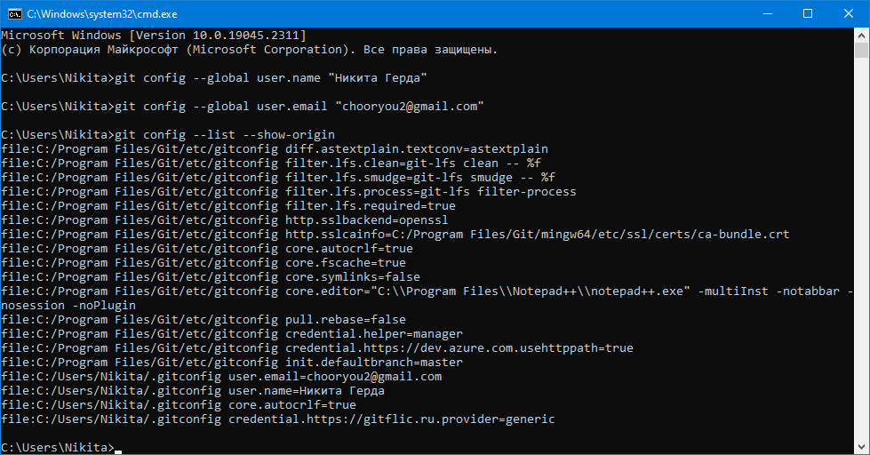
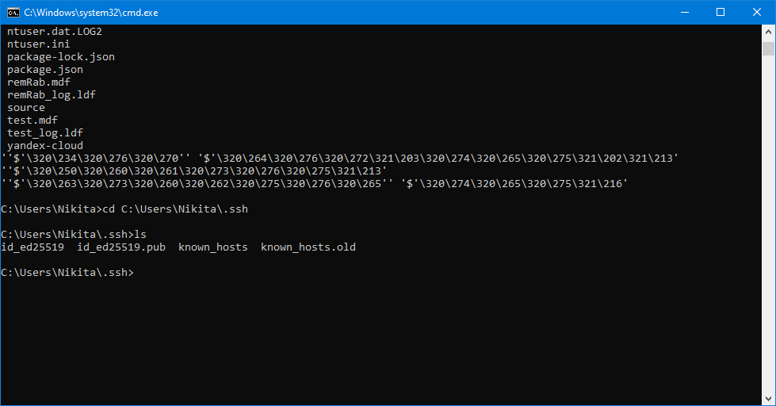
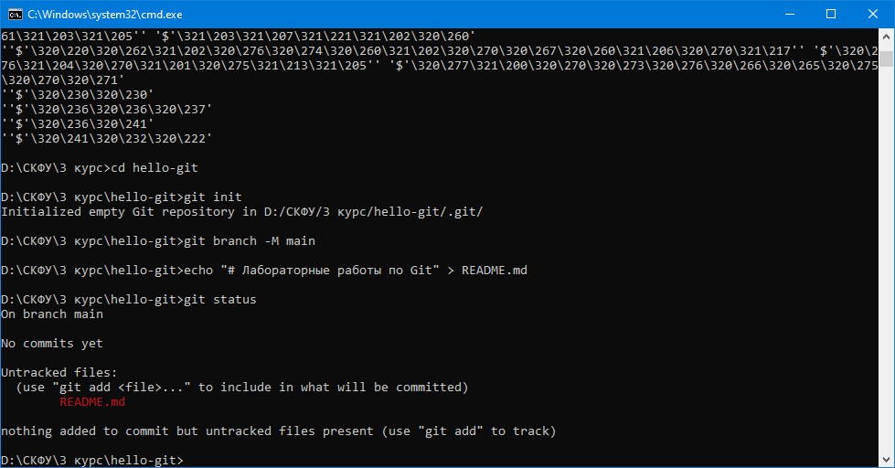
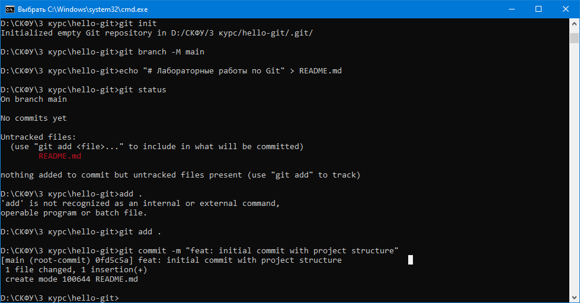
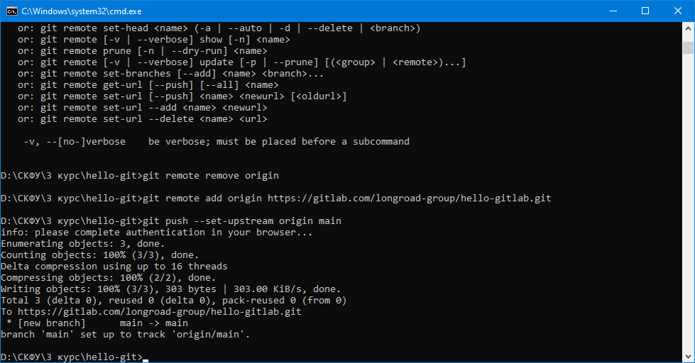

# Отчет по лабораторной работе №1
**Тема:** Установка, настройка системы контроля версий Git и интеграция с сервисом GitLab.

**Вариант:** 2026-10-25 

**Семестр:** 3 курс, 5 семестр

**Дисциплина:** Системы контроля версий

**Студент:** Герда Никита Андреевич 

**Группа:** ПИН-б-о-24-1  
---

## 1. Цель работы
Изучить принципы работы распределенной системы контроля версий Git, выполнить базовую настройку локального окружения, настроить безопасное подключение к удаленному репозиторию через протокол SSH, инициализировать проект и опубликовать первый коммит на GitLab.

---

## 2. Используемые инструменты
* Терминал (Bash / Zsh / Git Bash)
* Git CLI
* OpenSSH
* Платформа GitHub
* Редактор кода (VS Code / любой текстовый редактор)

---

## 3. Ход выполнения работы

### 3.1. Глобальная конфигурация пользователя
Перед началом работы с коммитами необходимо указать авторские данные: имя и адрес электронной почты, которые будут вшиваться в метаданные каждого снимка состояния проекта.

```bash
git config --global user.name "Иван Иванов"
git config --global user.email "ivanov@example.com"
git config --list --show-origin
```



---

### 3.2. Генерация и привязка SSH-ключа
Для взаимодействия с GitLab без постоянного ручного ввода логина и пароля используется криптографический ключ на базе алгоритма Ed25519.

1. Генерация ключевой пары:
   ```bash
   ssh-keygen -t ed25519 -C "ivanov@example.com"
   ```
2. Копирование содержимого открытого ключа:
   ```bash
   cat ~/.ssh/id_ed25519.pub
   ```
3. Добавление ключа в профиль: **GitLab** $\rightarrow$ **Settings** $\rightarrow$ **SSH and GPG keys** $\rightarrow$ **New SSH key**.
4. Проверка защищенного соединения:
   ```bash
   ssh -T git@gitlab.com
   ```



---

### 3.3. Инициализация репозитория и управление состоянием
В локальной рабочей папке создана структура файлов и выполнен первичный коммит.

1. Инициализация локального репозитория и установка ветки по умолчанию:
   ```bash
   git init
   git branch -M main
   ```

2. Создание файлов и проверка статуса отслеживания:
   ```bash
   echo "# Лабораторные работы по Git" > README.md
   git status
   ```



3. Добавление файлов в область подготовки (stage) и создание коммита:
   ```bash
   git add .
   git commit -m "feat: initial commit with project structure"
   ```



---

### 3.4. Подключение удаленного репозитория и публикация
1. На GitLab создан новый пустой репозиторий `GerdaNA2_1`.
2. Связывание локального репозитория с удаленным сервером:
   ```bash
   git remote add origin git@gitlab.com:USERNAME/REPO_NAME.git
   git remote -v
   ```

3. Отправка ветки `main` с установкой связи отслеживания (`upstream`):
   ```bash
   git push -u origin main
   ```



---

### 3.5. Итоговый результат
После завершения отправки изменений удаленный репозиторий на GitHub обновился. Ветка `main` содержит созданный коммит со всей файловой структурой.


---

## 4. Контрольные вопросы и ответы

1. **Чем рабочая директория (working directory) отличается от индекса (staging area)?**  
   Рабочая директория содержит реальные файлы на диске, с которыми работает пользователь. Индекс (staging area) — это промежуточная буферная зона, куда с помощью команды `git add` помещаются конкретные изменения, предназначенные для включения в следующий коммит.

2. **Зачем переименовывать начальную ветку из `master` в `main`?**  
   В современных версиях Git и на платформе GitHub имя `main` принято в качестве отраслевого стандарта для обозначения ветки по умолчанию.

3. **Что делает флаг `-u` (или `--set-upstream`) при первом `git push`?**  
   Он связывает локальную ветку с веткой на удаленном сервере. В дальнейшем для этой ветки достаточно вызывать просто `git push` или `git pull` без явного указания удаленного репозитория и имени ветки.

---

## 5. Вывод
В ходе лабораторной работы были освоены базовые операции Git: глобальная настройка профиля, генерация и связывание ключей SSH, инициализация локального репозитория, индексирование файлов и отправка данных в удаленный репозиторий GitLab.