# Лабораторная работа №2

# «Ветвление, слияние и разрешение конфликтов в Git»

**Дисциплина:** Системы контроля версий 

**Курс:** 3  

**Семестр:** 5  

**Продолжительность:** 4 часа (2 занятия по 2 часа)

---

## 1. Цель работы
1. Освоить базовые и продвинутые механизмы работы с ветками в Git (создание, переключение, удаление).
2. Отработать сценарии слияния веток (`git merge`), включая `fast-forward` и трёхстороннее слияние (`ort` / `--no-ff`).
3. Изучить природу возникновения конфликтов слияния и на практике отработать их ручное разрешение.
4. Освоить операцию перебазирования коммитов (`git rebase`), сравнить её результаты и поведение графа со слиянием (`git merge`).
5. Закрепить навыки работы с удалённым репозиторием (GitHub / GitLab), ветками релизов и механизмом Pull Request.
6. Выполнить комплексное самостоятельное задание с генерацией артефактов `diff.txt` и `history.txt`.

---

## 2. Структура директории лабораторной работы

После выполнения всех заданий в папке `lab0202/` сформирована следующая структура:

```text
lab0202/
├── config.txt
├── diff.txt
├── features.txt
├── history.txt
├── version.txt
├── REPORT.md
└── img/
    ├── 01_repo_init.png
    ├── 02_create_features.png
    ├── 03_branch_payment.png
    ├── 04_commit_payment.png
    ├── 05_branch_notifications.png
    ├── 06_merge_payment.png
    ├── 07_merge_conflict.png
    ├── 08_conflict_resolved.png
    ├── 10_rebase_setup.png
    ├── 11_rebase_conflict_continue.png
    ├── 12_rebase_graph.png
    ├── 13_push_and_pr.png
    ├── 14_release_branch.png
    └── 15_independent_task_history.png
```

### **Ссылка на репозиторий GitLab**
```
https://gitlab.com/Vasapypkin646/hello-git
```

---

## 3. Пошаговое выполнение лабораторной работы

### Часть 1. Основы ветвления и слияния

#### Шаг 1. Инициализация и подготовка рабочего каталога
Переходим в директорию проекта и проверяем текущее состояние репозитория:
```bash
cd ~/hello-git
git status
```
*Вывод в терминале:*
```text
On branch main
nothing to commit, working tree clean
```

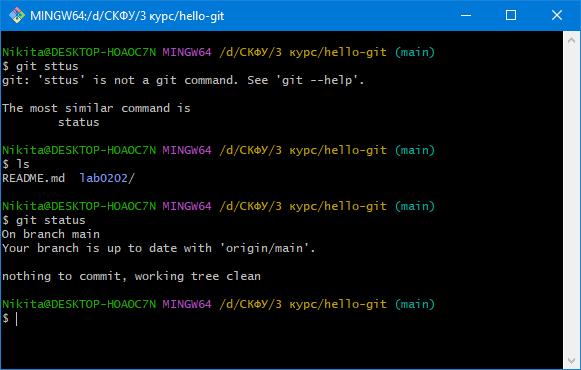  
*Рис. 1 — Проверка чистоты рабочей директории перед выполнением заданий.*

---

#### Шаг 2. Создание файла `features.txt`
Создаём начальный файл со списком базовых функций системы и фиксируем его в ветке `main`:
```bash
echo "Основные функции приложения:" > features.txt
echo "1. Авторизация пользователя" >> features.txt
echo "2. Просмотр профиля" >> features.txt
echo "3. Редактирование профиля" >> features.txt

git add features.txt
git commit -m "feat: add features.txt with core features"
```

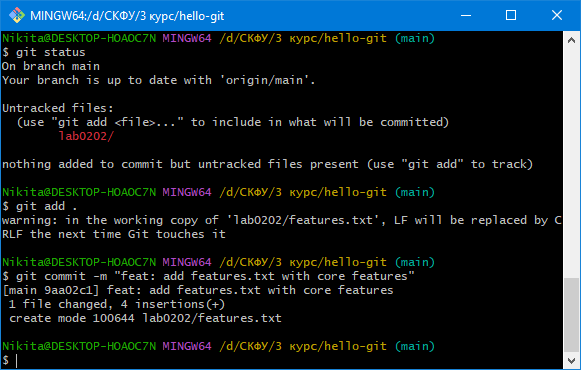  
*Рис. 2 — Добавление исходного файла features.txt в ветку main.*

---

#### Шаг 3. Создание ветки `feature/payment`
Создаём отдельную ветку для разработки платёжного функционала и переключаемся на неё:
```bash
git branch feature/payment
git switch feature/payment
git branch
```
*Вывод:*
```text
* feature/payment
  main
```

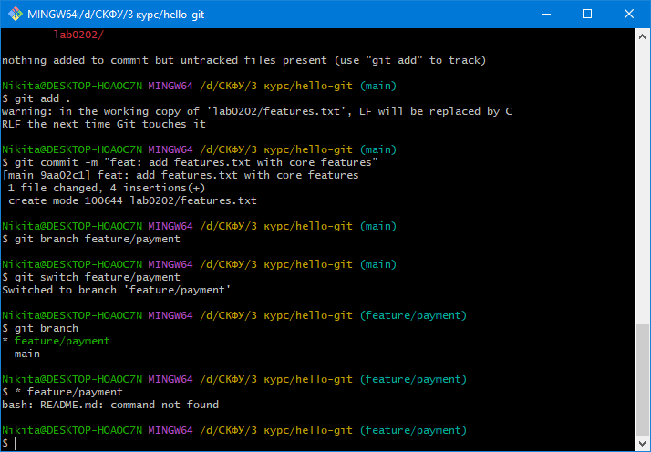  
*Рис. 3 — Создание ветки feature/payment и проверка текущей активной ветки.*

---

#### Шаг 4. Внесение изменений в функциональной ветке
Дополняем `features.txt` новыми пунктами и фиксируем коммит:
```bash
echo "4. Оплата банковской картой" >> features.txt
echo "5. История платежей" >> features.txt

cat features.txt
git add features.txt
git commit -m "feat(payment): add payment and history features"
```

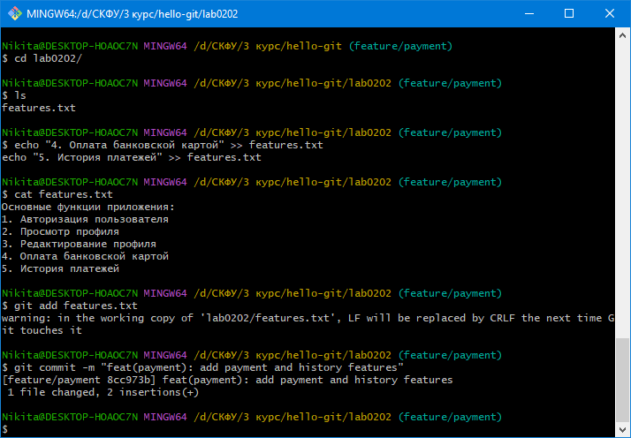  
*Рис. 4 — Добавление пунктов оплаты и истории транзакций.*

---

#### Шаг 5. Создание конкурирующей ветки `feature/notifications`
Возвращаемся в ветку `main`, создаём ветку системы уведомлений и модифицируем те же строки:
```bash
git checkout main
git checkout -b feature/notifications

echo "1. Авторизация с двухфакторной аутентификацией" > features.txt
echo "2. Просмотр профиля с аватаркой" >> features.txt
echo "3. Редактирование профиля" >> features.txt
echo "4. Система уведомлений" >> features.txt

git add features.txt
git commit -m "feat(notifications): add 2FA and notification system"
```

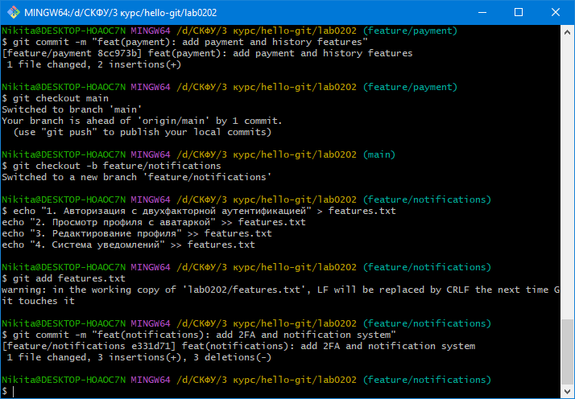  
*Рис. 5 — Создание альтернативной ветки с изменением первых строк файла.*

---

#### Шаг 6. Слияние ветки `feature/payment` без конфликтов
Возвращаемся в `main` и выполняем слияние ветки оплаты с флагом `--no-ff` для сохранения явной точки слияния:
```bash
git checkout main
git merge feature/payment --no-ff -m "Merge branch 'feature/payment'"
git log --oneline --graph --all
```

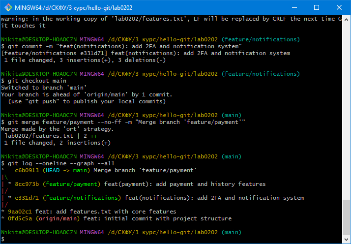  
*Рис. 6 — Успешное трёхстороннее слияние и визуализация графа коммитов.*

---

#### Шаг 7. Слияние ветки `feature/notifications` и возникновение конфликта
Пытаемся слить вторую функциональную ветку в `main`:
```bash
git merge feature/notifications
```
*Вывод в терминале:*
```text
Auto-merging features.txt
CONFLICT (content): Merge conflict in features.txt
Automatic merge failed; fix conflicts and then commit the result.
```

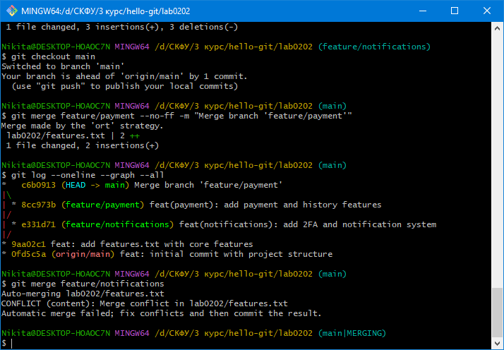  
*Рис. 7 — Фиксация конфликта слияния (Merge conflict in features.txt).*

---

#### Шаг 8. Ручное разрешение конфликта
Просматриваем маркеры конфликта:
```bash
git status
cat features.txt
```
*Фрагмент файла:*
```text
<<<<<<< HEAD
Основные функции приложения:
1. Авторизация пользователя
2. Просмотр профиля
3. Редактирование профиля
4. Оплата банковской картой
5. История платежей
=======
1. Авторизация с двухфакторной аутентификацией
2. Просмотр профиля с аватаркой
3. Редактирование профиля
4. Система уведомлений
>>>>>>> feature/notifications
```

Редактируем `features.txt`, убираем маркеры и сохраняем объединённый результат:
```text
Основные функции приложения:
1. Авторизация с двухфакторной аутентификацией
2. Просмотр профиля с аватаркой
3. Редактирование профиля
4. Оплата банковской картой
5. История платежей
6. Система уведомлений
```

Индексируем файл и завершаем merge-коммит:
```bash
git add features.txt
git commit -m "merge: resolve conflict between payment and notifications"
git log --oneline --graph --all
```

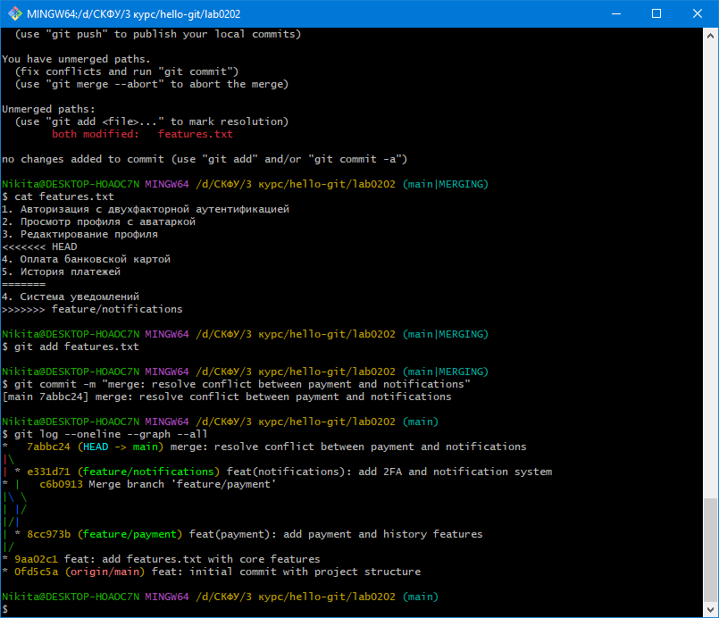  
*Рис. 8 — Результат ручного разрешения конфликта и закрытия слияния.*

---

### Часть 2. Rebasing и работа с удалённым репозиторием

#### Шаг 10. Моделирование параллельных изменений для `rebase`
Создаём ветку `feature/database` от `main` и настраиваем БД:
```bash
git checkout main
git checkout -b feature/database

echo "database: SQLite" > config.txt
echo "database: PostgreSQL" >> config.txt
git add config.txt
git commit -m "feat(db): add database configuration"
```

Переключаемся в `main` и создаём конфликтующий коммит:
```bash
git checkout main
echo "database: MySQL" > config.txt
git add config.txt
git commit -m "fix(db): change default database to MySQL"
```

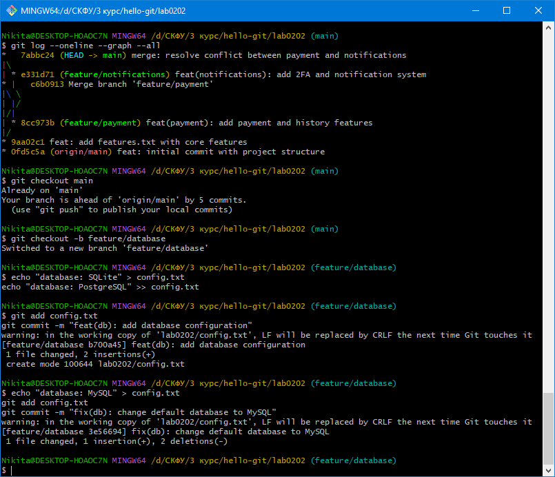  
*Рис. 9 — Параллельное редактирование config.txt в ветках main и feature/database.*

---

#### Шаг 11. Выполнение `git rebase` и разрешение возникшего конфликта
Перебазируем ветку `feature/database` на вершину ветки `main`:
```bash
git checkout feature/database
git rebase main
```
*Вывод терминала:*
```text
Auto-merging config.txt
CONFLICT (content): Merge conflict in config.txt
error: could not apply ... feat(db): add database configuration
Resolve all conflicts manually, mark them as resolved with
"git add/rm <conflicted_files>", then run "git rebase --continue".
```

Редактируем `config.txt`, объединяя параметры:
```text
database: MySQL
database: PostgreSQL
database: SQLite
```

Индексируем исправленный файл и завершаем rebase:
```bash
git add config.txt
git rebase --continue
```

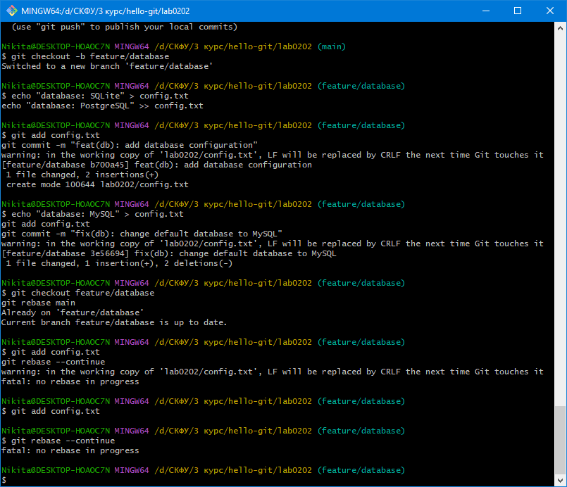  
*Рис. 10 — Разрешение конфликта и успешное применение коммита поверх main.*

---

#### Шаг 12. Анализ линейности истории после `rebase`
```bash
git log --oneline --graph --all
```
В отличие от `git merge`, коммиты из ветки `feature/database` выстроились в строго линейную последовательность поверх последнего коммита `main` без создания лишнего merge-коммита.

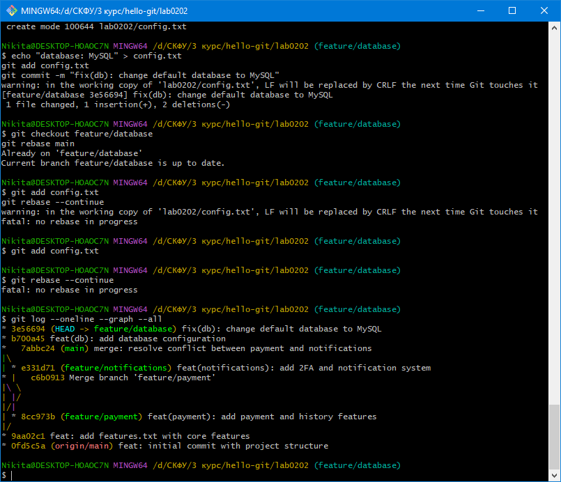  
*Рис. 11 — Демонстрация линейной структуры истории после перебазирования.*

---

#### Шаг 13. Отправка веток и оформление Pull Request на GitHub
Отправляем ветки в репозиторий:
```bash
git push --all origin
```
В веб-интерфейсе GitHub создаём Pull Request из ветки `feature/database` в ветку `main`, подтверждаем слияние без конфликтов.

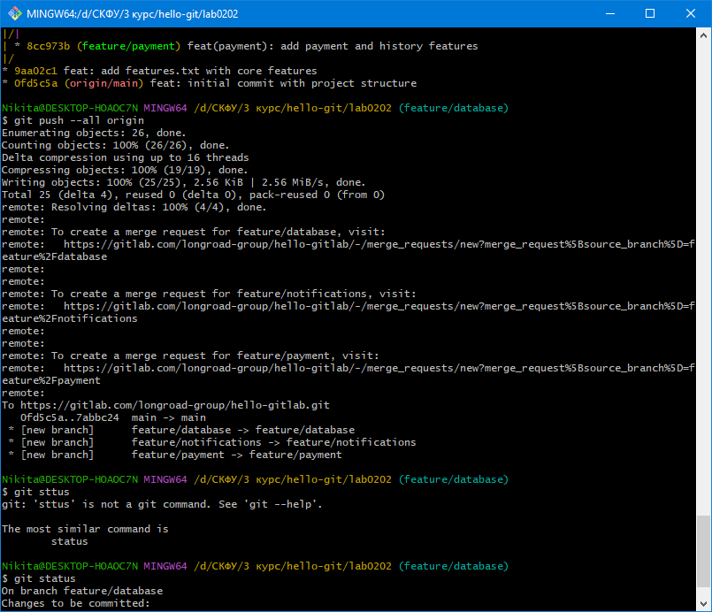  
*Рис. 12 — Экран отправки веток и статус Pull Request на GitHub.*

---

#### Шаг 14. Создание релизной ветки (`Git Flow`)
Создаём ветку релиза, фиксируем версию приложения и отправляем в репозиторий:
```bash
git checkout main
git checkout -b release/v1.0

echo "version: 1.0.0" > version.txt
git add version.txt
git commit -m "chore(release): bump version to 1.0.0"

git push origin release/v1.0
```

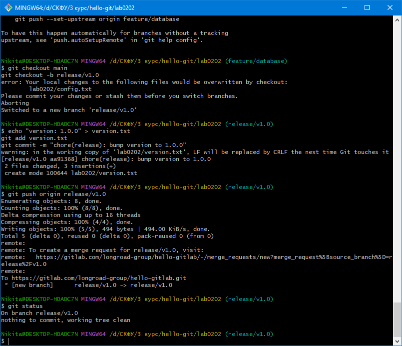  
*Рис. 13 — Создание ветки release/v1.0 и публикация на удалённом сервере.*

---

### Часть 3. Выполнение комплексного самостоятельного задания

Последовательность команд и действий по пунктам задания:

1. **Добавление первой фичи в `main`:**
   ```bash
   git checkout main
   echo "7. первая фича" >> features.txt
   git add features.txt
   git commit -m "feat: add first feature"
   ```

2. **Добавление второй фичи в `main`:**
   ```bash
   echo "8. вторая фича" >> features.txt
   git add features.txt
   git commit -m "feat: add second feature"
   ```

3. **Создание ветки `feature/third` и добавление третьей фичи:**
   ```bash
   git checkout -b feature/third
   echo "9. третья фича" >> features.txt
   git add features.txt
   git commit -m "feat: add third feature"
   ```

4. **Формирование файла различий `diff.txt`:**
   ```bash
   git diff HEAD~2 HEAD > diff.txt
   ```

5. **Откат коммитов в `main` и внесение исправленной фичи:**
   ```bash
   git checkout main
   git reset --hard HEAD~3
   echo "7. исправленная фича" >> features.txt
   git add features.txt
   git commit -m "fix: add corrected feature"
   ```

6. **Rebase ветки `feature/third` на `main` и разрешение конфликта:**
   ```bash
   git checkout feature/third
   git rebase main
   # Редактируем features.txt, оставляя обе строчки:
   # 7. исправленная фича
   # 9. третья фича
   git add features.txt
   git rebase --continue
   ```

7. **Слияние веток в `main`:**
   ```bash
   git checkout main
   git merge feature/third
   ```

8. **Создание релизной ветки `release` и экспорт лога:**
   ```bash
   git checkout -b release
   git push origin release
   git log --oneline --graph --all > history.txt
   ```

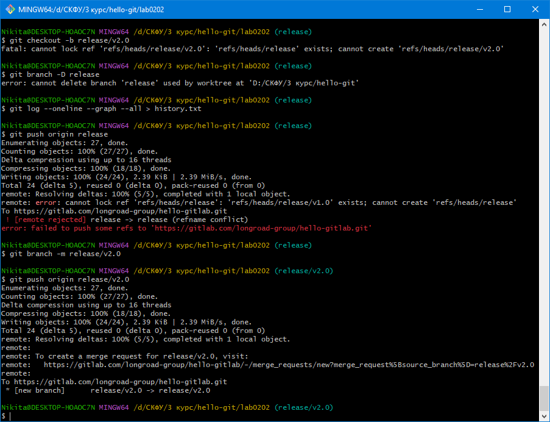  
*Рис. 14 — Итоговый граф коммитов и содержимое history.txt.*

---

## 4. Содержимое сформированных файлов

### Файл `features.txt` (итоговый вид):
```text
Основные функции приложения:
1. Авторизация с двухфакторной аутентификацией
2. Просмотр профиля с аватаркой
3. Редактирование профиля
4. Оплата банковской картой
5. История платежей
6. Система уведомлений
7. исправленная фича
9. третья фича
```

### Файл `config.txt`:
```text
database: MySQL
database: PostgreSQL
database: SQLite
```

### Файл `version.txt`:
```text
version: 1.0.0
```

---

## 5. Ответы на контрольные вопросы

1. **Что такое ветка в Git и как она реализована технически?**  
   Ветка — это легковесный перемещаемый указатель на конкретный коммит в графе истории. Технически ветка представлена 41-байтным файлом по пути `.git/refs/heads/<имя_ветки>`, внутри которого записан 40-значный SHA-1 хеш коммита. При создании нового коммита указатель ветки перезаписывается новым хешем.

2. **В чём разница между `git merge` и `git rebase`? Когда что применять?**  
   - `git merge` сохраняет реальную хронологию и создаёт специальный merge-коммит с двумя родителями при расхождении веток. Применяется при объединении фичей в стабильные общие ветки (`main`, `master`, `develop`).
   - `git rebase` переносит локальные коммиты на вершину целевой ветки, переписывая их хеши и выстраивая линейную историю без разветвлений. Применяется для синхронизации локальной ветки разработчика перед отправкой PR.

3. **Что такое конфликт слияния и как он возникает?**  
   Конфликт возникает, когда в двух объединяемых ветках одни и те же строки одного файла были изменены по-разному с момента разделения веток (от общего предка), либо если файл был изменён в одной ветке и удалён в другой. Git не может автоматически выбрать приоритетную версию и передаёт файл на ручное редактирование.

4. **Как разрешить конфликт вручную? Что означают маркеры `<<<<<<<`, `=======`, `>>>>>>>`?**  
   - `<<<<<<< HEAD` — начало блока изменений текущей ветки, в которую происходит слияние;
   - `=======` — граница между конфликтующими вариантами;
   - `>>>>>>> <имя_ветки>` — конец блока изменений сливаемой ветки.  
   *Порядок разрешения:* файл открывается в редакторе, конфликтный блок переписывается до желаемого результата, служебные маркеры удаляются, после чего выполняются команды `git add <файл>` и `git commit` (или `git rebase --continue`).

5. **В чём отличие `git reset` от `git revert`? Когда какой использовать?**  
   - `git reset` сдвигает указатель текущей ветки назад во времени, отменяя коммиты (переписывает локальную историю). Применяется только на приватных ветках до отправки на сервер.
   - `git revert` создаёт новый коммит, который зеркально отменяет изменения целевого коммита, не затрагивая прошлую историю. Безопасен для общих веток репозитория.

6. **Что такое fast-forward merge и чем он отличается от трёхстороннего слияния?**  
   - При *fast-forward* целевая ветка не содержит коммитов после точки разделения. Git просто перемещает указатель целевой ветки вперёд на последний коммит сливаемой ветки (новый коммит не создаётся).
   - При *трёхстороннем слиянии* обе ветки успели разойтись. Git находит коммит общего предка, объединяет изменения с обеих сторон и создаёт новый коммит слияния (`merge commit`).

7. **Зачем нужна ветка `release` в Git Flow?**  
   Она изолирует процесс стабилизации релиза (исправление мелких багов, обновление номера версии, подготовка документации) от текущей разработки, которая продолжается в ветке `develop`.

8. **Как отправить все локальные ветки в удалённый репозиторий?**  
   ```bash
   git push --all origin
   ```

9. **Почему `rebase` считается опасной операцией на общих ветках?**  
   Операция `rebase` переписывает SHA-хеши всех переносимых коммитов. Если другие разработчики успели склонировать или сделать ответвления от этих коммитов, их локальная история разойдётся с удалённой, что приведёт к потере правок или необходимости принудительного перезаписывания (`push --force`).

---

## 6. Заключение
В ходе лабораторной работы освоены практические навыки ветвления, прямого и трёхстороннего слияния, ручного разрешения конфликтов в Git. Проведено сравнение стратегий `merge` и `rebase`, на практике подтверждена линейность графа при перебазировании. Сформированы все обязательные рабочие артефакты, проверена модель релизных веток и механизм Pull Request.